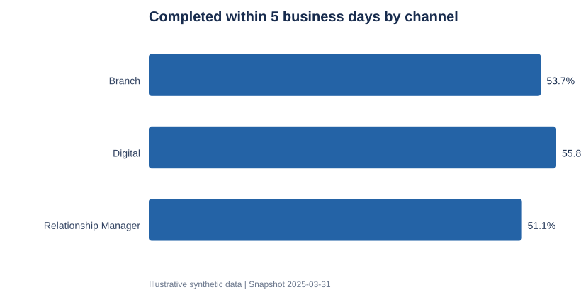
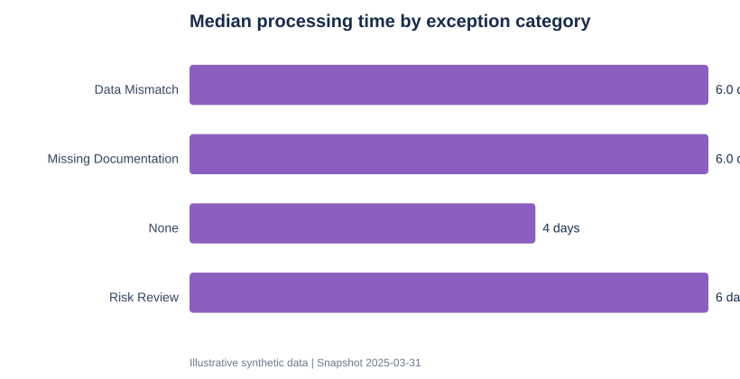
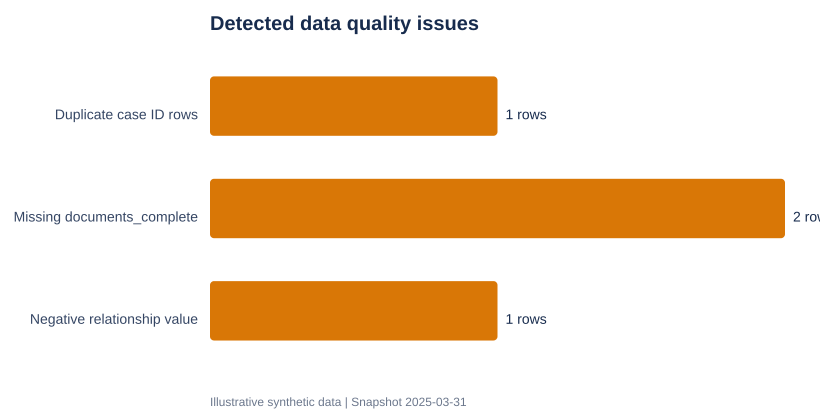

# Client Onboarding Operations Analysis

**Dataset:** fictional, deterministically generated sample | **Snapshot:** 2025-03-31  
**Purpose:** demonstrate an end-to-end operational data analysis workflow. These findings do not describe any real bank or its clients.

## Executive summary

- **600** cases were included; **538** were completed and **62** remained open at the snapshot.
- Completion rate among date-valid cases: **89.7%**. SLA attainment among completed cases: **53.7%** within the illustrative five-business-day target.
- Completed cases had a median processing time of **5.0 business days** (mean: 5.2 days).
- **26** open cases were older than five business days at the snapshot.
- Validation found **4 issue occurrences** across 3 issue types. A row may contribute to more than one issue type.

## KPI definitions

| KPI | Result | Definition |
|---|---:|---|
| Total cases | 600 | Input rows, including rows flagged by quality checks |
| Completion rate | 89.7% | Completed / date-valid cases |
| SLA attainment | 53.7% | Completed in 5 or fewer business days / completed cases |
| Median processing time | 5.0 days | Median weekday count between receipt and completion |
| Open backlog over 5 days | 26 | Still-open cases older than 5 business days on snapshot date |

## Findings

### Channel comparison

- **Branch:** 53.7% within SLA across 108 completed cases (median 5.0 business days).
- **Digital:** 55.8% within SLA across 240 completed cases (median 5.0 business days).
- **Relationship Manager:** 51.1% within SLA across 190 completed cases (median 5.0 business days).

The highest observed channel SLA attainment was **Digital**. This is a descriptive result from randomized fictional data and is not evidence that the channel caused the difference.

### Exception comparison

- **Data Mismatch:** median 6.0 business days across 76 completed cases; SLA attainment 48.7%.
- **Missing Documentation:** median 6.0 business days across 102 completed cases; SLA attainment 32.4%.
- **None:** median 4 business days across 309 completed cases; SLA attainment 63.8%.
- **Risk Review:** median 6 business days across 51 completed cases; SLA attainment 43.1%.

**Data Mismatch, Missing Documentation, Risk Review** had the longest median processing time in this sample. Use this as a prompt to inspect handoffs and case notes, not as a causal conclusion.

### Data quality

| Issue type | Rows |
|---|---:|
| Duplicate case ID rows | 1 |
| Missing documents_complete | 2 |
| Negative relationship value | 1 |

## Recommended operational actions

1. **Triage aged open cases daily.** Start with cases beyond the five-day illustrative target; assign an owner, next action, and due date.
2. **Prevent avoidable document exceptions.** Use a standardized intake checklist and clear missing-document requests, then track repeat causes.
3. **Add validation at intake.** Require key fields, enforce permitted values, and check date and amount plausibility before a case enters downstream processing.
4. **Review exception handoffs.** Map the steps for risk review and data mismatch cases; measure time waiting at each handoff before changing the process.
5. **Monitor trends with richer data.** In a real analysis, segment by complexity, staffing, product, geography, holiday calendar, and case age while applying privacy and access controls.

## Limitations

- Synthetic data is generated for demonstration; counts, distributions, and relationships have no real-world evidentiary value.
- Cases are randomly assigned channel, segment, exception, and risk tier. Differences across groups are illustrative and not causal.
- The five-business-day target is a project assumption, and the weekday calendar excludes holidays.
- The data has no timestamps for intermediate steps, so it cannot isolate queue time from active processing time.
- Relationship value is included only for schema practice and is not used to rank clients or make decisions.

## Reproducibility

Run `python scripts/generate_data.py` followed by `python scripts/analyze.py`. Tabular outputs are in this folder: `overall_kpis.csv`, `by_channel.csv`, `by_segment.csv`, `by_exception.csv`, and `data_quality_issues.csv`.
